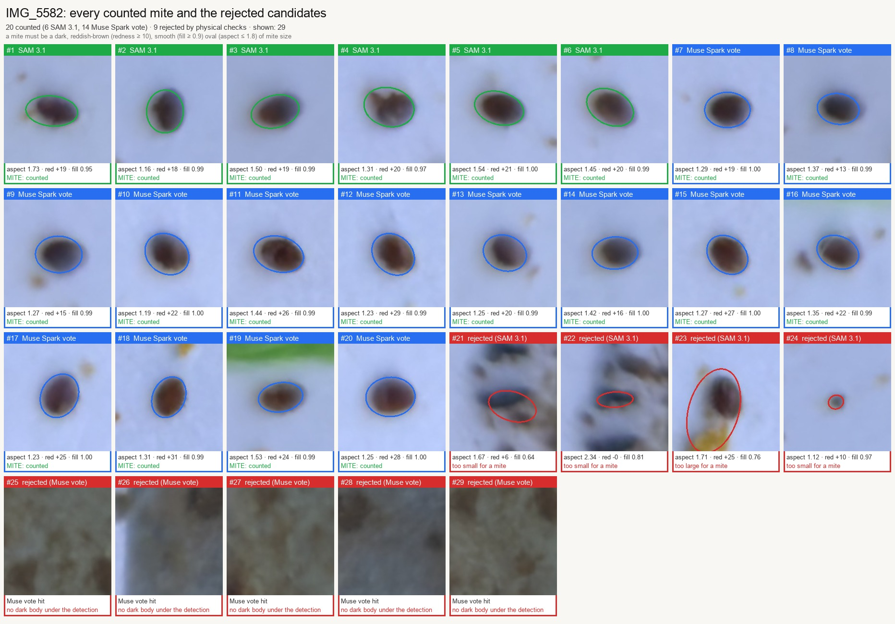
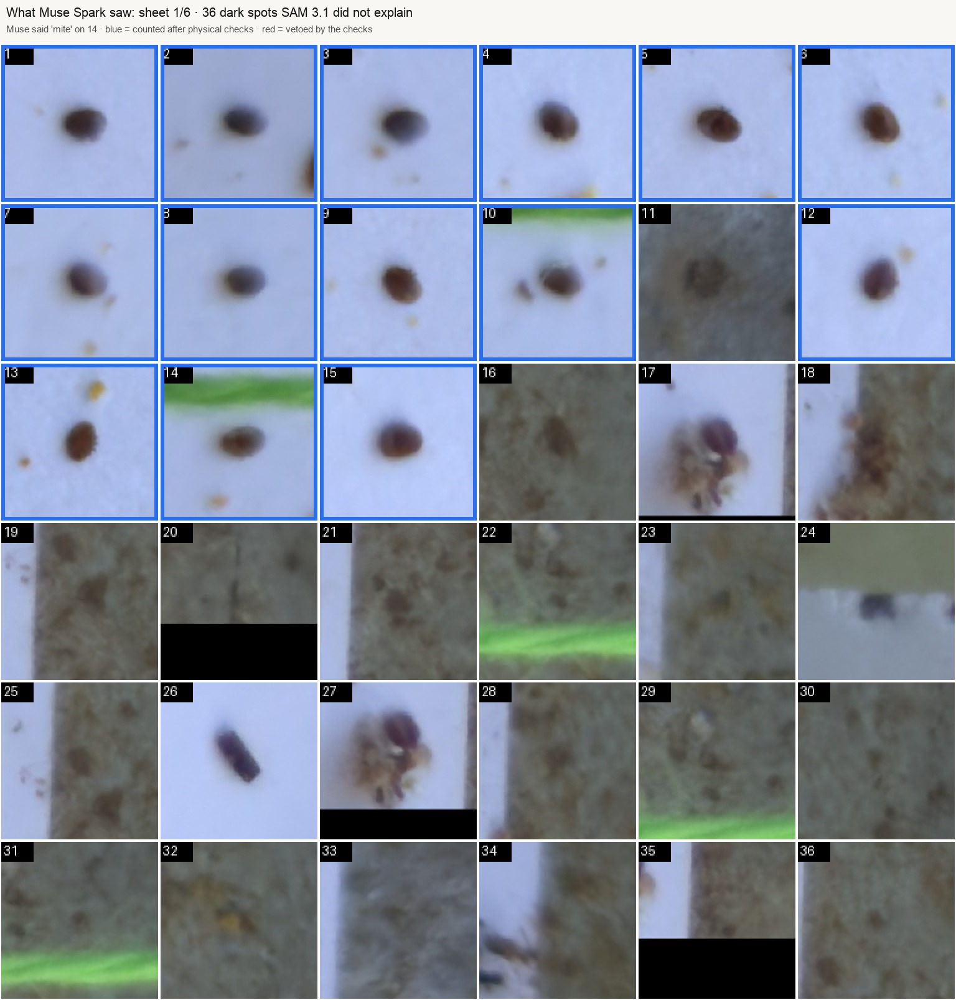

# 🐝 HiveLens

**A hive inspection agent that measures before it speaks.**
Photograph a frame and the sticky board from under the hive. **SAM 3.1** segments mites,
capped honey, brood, pollen and bees. Plain code turns the masks into numbers. **Muse Spark**
looks at the photos, states hypotheses, and every hypothesis is checked against the
measurements before it may appear in the report.

> Meta Global AI Developer Hackathon 2026 · Indie Developer track · *Push the Frontier* (science)

---

## Why

Varroa destructor is one of the most destructive threats to honey bee colonies. The standard
way to monitor it is to count the mites that fall onto a sticky board under the hive, which
beekeepers do by eye, mite by mite. Judging stores and brood means reading every frame by eye too.
Both jobs are slow, so they are done less often than they should be.

HiveLens turns two photos into a measured inspection, and keeps every inspection so the
beekeeper sees trends rather than snapshots.

## How it works

```
 frame photo ─┐                       ┌─ honey / brood / pollen / bees % ─┐
              ├─ SAM 3.1 (text prompts) ┤                                     ├─ rules → good / watch / act
 board photo ─┘   tiled at full res    └─ mite count → mites per day ───────┘           │
                                                                                         ▼
                  Muse Spark: look at photos → hypotheses → check_claim ✅/❌ → measurements,
                  history, extra SAM queries → report (only findings backed by verified claims)
```

1. **SAM 3.1** is open-vocabulary, so every object is just a text concept:
   `varroa mite` on the board, `honeycomb` and `honey bee` on frames.
   **Frames:** asked for `capped honey cells` or `capped brood cells`, SAM returns one region
   covering the whole frame (on three test frames it called 85–93% of the comb "brood"), because
   these are textures, not objects. So SAM gives the geometry (comb outline, every bee as a mask),
   the comb is cut into a grid of tiles, and **Muse Spark labels each tile** on numbered sheets
   (capped honey / capped brood / open brood / pollen / nectar-empty / unreadable).
   Sticky-board photos are ~49 MP and a mite body is ~30 px. We measured how SAM 3.1's
   zero-shot recall depends on scale (`scripts/probe_prompts.py`, crops around expert-annotated
   mites): with the prompt `varroa mite` it found 0/3 mites in 1344 px crops, 2/3 in 600 px
   and 3/3 in 300 px, with zero false hits. So the board is read in two passes:
   a 600 px grid (parallel requests), then every dark mite-sized spot the grid did not explain
   is re-checked by SAM 3.1 on a tight 300 px crop. Spots SAM still does not recognise are cut
   out onto numbered contact sheets (36 per sheet) and **Muse Spark votes** on which ones are
   mites. Every candidate from every pass must then pass physical checks (dark body of mite
   size, reddish-brown relative to the board, smooth oval outline) before it is counted.
2. **Deterministic engine** (`hivelens/measure.py`, `hivelens/engine.py`, no model):
   mite size/shape sanity checks reject debris (shown as ❌ on the overlay), comb composition
   in % of visible comb with bees treated as occlusion, honey kg estimate, weeks of stores,
   change since the previous inspection.
3. **Rules** set the traffic light (good / watch / act). The model explains it, it cannot change it.
4. **Muse Spark agent** (`hivelens/agent.py`, tool calling):
   - measurements are hidden until it has committed to two visual hypotheses;
   - `check_claim` returns *verified / rejected / unverifiable* with the measured value;
   - it can read the hive history and run extra SAM 3.1 queries (`queen cell`, `drone brood`, …);
   - `submit_report` keeps only findings that cite verified claims; the rest are shown as discarded.
5. **Hive history and export**: each hive keeps its inspections; one click exports a ZIP with
   photos, overlays, reports, agent traces and `metrics.csv`.
6. **Evidence images** (`hivelens/viz.py`), saved with every board inspection:
   - `board_evidence.jpg`: a close-up of every counted mite and of the rejected candidates, with
     the fitted ellipse and the numbers the checks used (aspect, redness, fill) and the verdict;
   - `board_muse_sheet_*.jpg`: the exact contact sheets Muse Spark was shown, with its votes
     (blue = counted, red = Muse said "mite" and the physical checks vetoed it).

Every model called at runtime is a Meta model, through the Meta Model API:

| Job | Model |
|---|---|
| Segmentation | `sam-3.1` |
| Vision, reasoning, tool calling | `muse-spark-1.3` |

## Quick start

Needs **Python 3.10+** (Meta's `meta-sam-parser` requires it; macOS ships 3.9).
With [uv](https://docs.astral.sh/uv/) it is one line, uv fetches the right Python itself:

```bash
uv venv --python 3.12 && source .venv/bin/activate
uv pip install -r requirements.txt
cp .env.example .env            # paste your MODEL_API_KEY
python scripts/check_api.py     # checks both models in ~10 s
python server.py                # launches the enterprise web console at http://127.0.0.1:8502
```

(Alternatively, `streamlit run app.py` launches the single-hive Streamlit notebook view.)

Optional, for the benchmark and a demo hive with history:

```bash
python scripts/download_varroa.py        # public sticky-board dataset, ~350 MB
python scripts/eval_varroa.py --n 5      # SAM 3.1 vs expert counts vs classic CV
python scripts/seed_demo.py --boards 3   # demo hive with 3 weekly inspections
python scripts/demo_assets.py            # same board/frames: Meta models used naively vs HiveLens
```

SAM answers are cached in `data/cache/`, so re-running a demo or a benchmark costs nothing.
Offline tests (no key needed): `pytest -q`.

## Benchmark

Expert-annotated sticky boards from the public dataset below (taken in file-name order).
Zero-shot: no model is trained on this data.

**Held-out test: boards 9–20, 128 mites. Nothing was tuned on these boards.**

| | HiveLens (SAM 3.1 + Muse Spark + checks) | Classic darkness threshold |
|---|---|---|
| Precision | **0.76** | — |
| Recall | **0.69** | — |
| F1 (box match) | **0.72** | ~0.1 |
| Count error per board (MAE) | **3.0 mites** | 142 mites |

Per half: boards 9–14 F1 0.80 (MAE 2.5), boards 15–20 F1 0.66 (MAE 3.5).
Counts are close even where box matching is imperfect, because misses and false hits partly cancel;
the mite count is what drives the beekeeper's decision.

**How we got there (development boards 1–8):**

| Step | Result |
|---|---|
| SAM 3.1, prompt `varroa mite`, 1344 px tiles | 0 mites found: a mite is too small in the model's input |
| Probe of crop size around annotated mites | 1344 px 0/3, 600 px 2/3, 300 px 3/3, no false hits |
| 600 px grid + 300 px SAM re-check of dark spots + size/colour checks | F1 0.47 (precision 0.70, recall 0.35) |
| + Muse Spark vote on spots SAM did not recognise | F1 0.76 (precision 0.67, recall 0.88) |
| + shape checks (smooth oval, aspect ≤ 1.8), set on boards 3–8 | F1 0.83 on boards 3–8 |
| Tried and dropped: a second, zoomed Muse look and a softer darkness threshold | F1 fell to 0.72 on boards 3–14, reverted |

Reproduce the test: `python scripts/eval_varroa.py --n 12 --skip 8` (or the **Benchmark** tab).
Per-board numbers, overlays and a cut-out of every false hit and miss: `data/eval/varroa_eval.json`.

### Visual Ablation: Naive Meta Model Calls vs. HiveLens Pipeline

**1. 49 MP Sticky Board (`IMG_5582`, 16 expert-annotated mites):**
Naive `SAM 3.1` (`"varroa mite"`) finds **0 / 16** mites because ~30 px targets vanish when downscaled; naive `Muse Spark` single-image prompting guesses *"25–30 mites"* without coordinates; **HiveLens** (`600 px → 300 px` SAM 3.1 tiling + `6×6` Muse Spark contact-sheet voting + morphology gate) counts **15 / 16** mites with **15 true hits and 0 false positives**:


| Morphology Gate Audit (`board_evidence.jpg`) | Muse Spark `6×6` Contact Sheet (`board_muse_sheet_1.jpg`) |
|---|---|
|  |  |

**2. Comb Frame Composition (`A slice of the brood nest`):**
Naive `SAM 3.1` text prompts (`"capped brood cells"`, `"capped honey cells"`) segment the entire frame as a single region (**86% brood / 99% honey**); **HiveLens** uses `SAM 3.1` for comb/bee geometry and `Muse Spark` tile classification for granular cell composition:


## Built during the hackathon (Oct 26 – Nov 4, 2026)

Everything in this repository was written during the event:
the SAM 3.1 client with tiling and caching, the measurement engine and rules, the claim
verifier, the Muse Spark agent and its tools, the hive store and export, the enterprise web
console (`server.py`, `hivelens/ui.html`, `hivelens/static/`) with multi-hive fleet registry and
spatial yard matrix, the Streamlit app (`app.py`), the benchmark and ablation scripts
(`scripts/eval_varroa.py`, `scripts/demo_assets.py`), and the offline test suites
(`tests/test_offline.py`, `tests/test_web.py`).

Not ours, and used under their terms:
- **Meta SAM 3.1 and Muse Spark**, called through the Meta Model API;
- **`meta-sam-parser`** (Meta) to decode SAM's mask format;
- **the varroa dataset** below, used only as evaluation data and demo photos (no model from that work is used).

## Data and credits

- Divasón J., Romero A., Martínez de Pisón F.J., Silvestre M.A., Santolaria P., Yániz J.L. (2023).
  *Dataset for varroa mite detection on sticky boards.* Zenodo.
  [doi:10.5281/zenodo.10231845](https://doi.org/10.5281/zenodo.10231845). License **CC BY 4.0**.
  Paper: *Analysis of Varroa Mite Colony Infestation Level Using New Open Software Based on Deep Learning Techniques*, Sensors 2024.
- Raw dataset archives (~350 MB) are downloaded by `scripts/download_varroa.py` and are not stored in git; downscaled evaluation figures in `data/demo_assets/` are included with attribution under CC BY 4.0.
- Demo frame photos from Wikimedia Commons, fetched by `python -m hivelens.commons` (rendered comparison figures in `data/demo_assets/` included under their respective licenses):
  "Cadre de corps de ruche" by Marc Andrighetti (CC BY-SA 3.0);
  "Frame from hive of honey bee (apis mellifera)" by John Pons (CC BY-SA 4.0);
  "A slice of the brood nest" by Einebillion (CC BY 4.0).
- In the demo hive, boards from different colonies are shown as consecutive weekly
  inspections of one hive to illustrate the history view.

Related prior work that inspired the problem framing: DeepBee (Alves et al., 2020) for comb cell
classification, and the varroa detector above. HiveLens trains nothing; it combines a
zero-shot segmentation model with verified reasoning.

## Limitations

- **Comb reading has no benchmark yet**: we found no openly licensed frame photos with expert
  cell-level labels, so frame results were only checked by eye on three Commons photos.
  SAM's comb outline can include a neighbouring frame, which inflates "empty".

- Thresholds in `hivelens/config.py` are starting points; mite-drop thresholds depend on
  season, region and colony size.
- Stores are extrapolated from the photographed frame sides.
- HiveLens reports measurements and suggests what to check; it is not a veterinary diagnosis.

## Roadmap

Camera capture is available now in **New inspection → Photos → Camera / video**.
Use a device camera, open a local video, or try the bundled recorded demo.
Capture a still, review/retake it, add it as a sticky board or frame side, then
run the normal inspection. Capture source, time, resolution and video position
are saved with the report and exported JSON. Camera preview stays local;
accepted photos are uploaded only when the inspection is submitted.
The camera stops when leaving the view or hiding the tab. Browser camera access
requires HTTPS or localhost. This is still-frame analysis, not video tracking
or unattended scheduled monitoring.

The bundled comb close-up is **Queen honey bee laying eggs**, Ask a Biologist,
Arizona State University, CC BY-SA 3.0. It is clearly labelled recorded demo
footage, not the selected colony. An inspection containing a demo capture stays
in history but is excluded from the colony's status, trends and metrics CSV.
See [media attribution](hivelens/static/comb-demo-LICENSE.md).

- A fixed camera under the board for automatic daily counts.
- Inter-apiary anonymised telemetry sharing for regional mite-pressure maps.
- Video of a whole frame with SAM 3.1 tracking instead of single photos.

## License

MIT © 2026 Bakhtiyar
