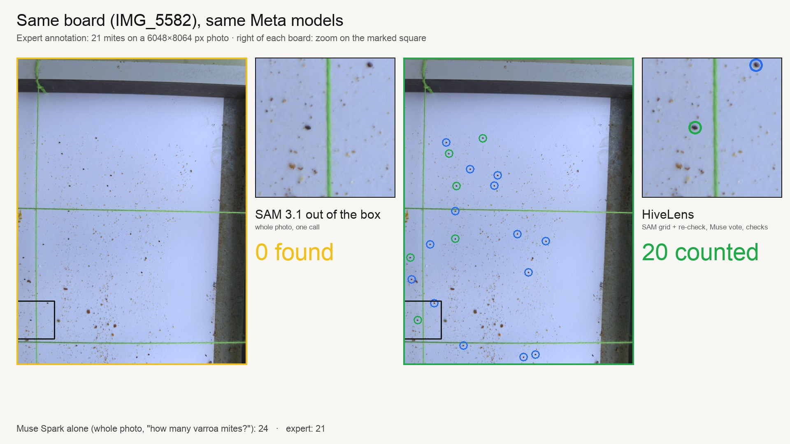
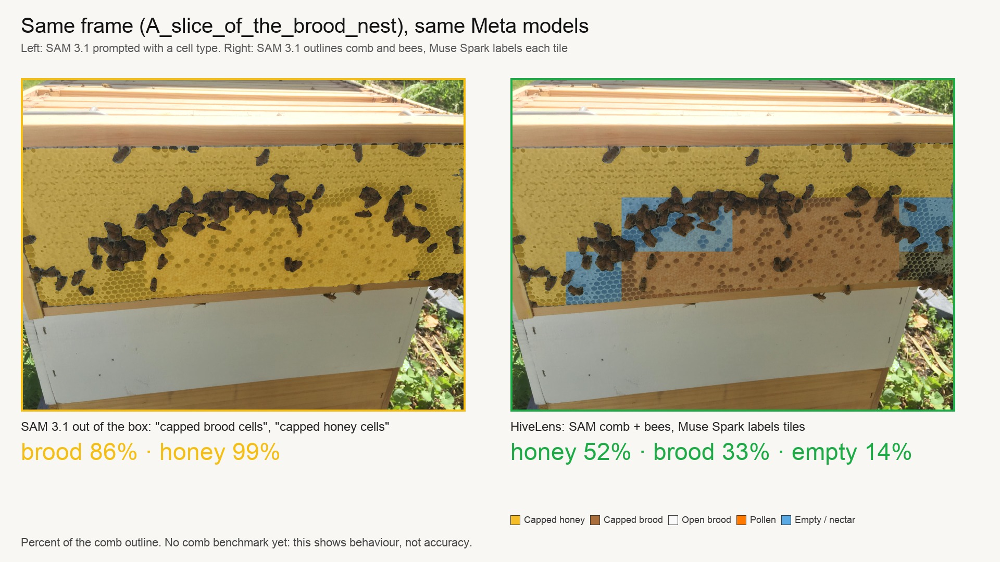

# HiveLens

**A hive inspection agent that measures before it speaks.**

[Open HiveLens on Railway](https://hivelens-production.up.railway.app/?mode=demo#welcome)
· [Watch the demo on YouTube](https://www.youtube.com/watch?v=taEsdckX_h4)

No installation or password is needed to explore saved analyses, photographs,
benchmarks and published study histories, or to start one fixed live sample analysis
(a public frame photo, limited shared runs). Analyses of your own photos and shared edits
require owner sign-in.

HiveLens turns sticky-board and comb photographs into an inspection you can audit:
counts, visible comb composition, marked-up images, checked claims and a saved report.
**SAM 3.1** supplies segmentation; **Muse Spark** interprets image tiles and reasons over
measurements. Deterministic code checks the agent’s claims before they enter the findings.

Built for the **Meta Global AI Developer Hackathon 2026 · Indie Developer track**.
See [team contributions and third-party materials](docs/CONTRIBUTIONS.md) for what
the submission implements and what it reuses.

## What makes it worth exploring

- **Evidence beside the answer.** Inspect counted mites, rejected candidates, overlays,
  contact sheets and the values behind each verified claim.
- **A workflow beyond a single prompt.** Separate farms and hives, inspect photos or
  captured video frames, follow records, and export the evidence as a ZIP.
- **Measurements constrain the agent.** The agent commits to visual hypotheses, checks
  them against computed measurements, and cites verified claims in its findings.
  Rule-based status cannot be overridden by the language model.
- **A reproducible comparison.** Saved results compare the pipeline with expert
  annotations and a classical darkness-threshold baseline. See the limitations below.
- **Real longitudinal context.** A separate archive contains published observations
  from **57 study hives in Denmark and Portugal, 2019–2020**, with original IDs, dates,
  methods, units and links to the EFSA MUST-B dataset and report.

HiveLens supports inspection and review. It does not diagnose all bee diseases or
establish that a colony is healthy from a photograph.

## Try the hosted project

These links open the deployed Railway server:

| Workspace | Public link | Data |
|---|---|---|
| Demo | [Start here](https://hivelens-production.up.railway.app/?mode=demo#welcome) | Attributed saved photo analysis, overlays and checked findings |
| Production | [Study apiary](https://hivelens-production.up.railway.app/?mode=production#overview) | Seven imported Serra da Lousa study hives; historical research, not a live deployment |
| Field dataset | [Published research](https://hivelens-production.up.railway.app/?mode=demo#research) | Read-only EFSA MUST-B archive, accessible from both workspaces |

The Meta API key is configured **on the Railway server** and is never sent to the
browser. Public visitors cannot spend it or modify shared records. The owner can
sign in at `/login` to access analysis and editing controls.

**Cloud analysis status (5 Nov 2026, Almaty):** saved results work. New Meta model
requests from Railway currently return `404 model_not_found`, despite successful
local checks with the same key and model IDs. Live cloud inference is not yet
verified; use the saved evidence to review the project. This is separate from the
automated test suite, which runs without paid model calls (commands below).

## Start locally — on your own computer

Use **Python 3.12** for the tested, pinned setup. With [uv](https://docs.astral.sh/uv/):

```bash
git clone https://github.com/AbulkasimovBakhtiyar2006/HiveLens.git
cd HiveLens
uv venv --python 3.12
uv pip install --python .venv -r requirements-lock.txt
uv run --python .venv python server.py
```

Open **http://127.0.0.1:8502/**. The same commands work in macOS/Linux shells and
Windows PowerShell; no shell activation is required. The first import of image/model
libraries can take a little time before the server prints its URL.

**No API key is needed to review the project.** A fresh demo workspace automatically
receives one [attributed saved model run](hivelens/examples/photo-analysis/ATTRIBUTION.md),
including original photos, overlays, checked claims and the model trace. It makes no
new model calls. Existing workspaces are preserved; Production starts empty.
The field archive, benchmark and mite guide also work without a model key.

To run **new** analyses, copy `.env.example` to `.env`, set `MODEL_API_KEY`, and restart.
Do not commit `.env`. If port 8502 is occupied, set `HIVELENS_PORT` to another port.
With standard Python instead of uv: `python3.12 -m venv .venv`, activate the environment,
then `python -m pip install -r requirements-lock.txt` and `python server.py`.
`python scripts/check_api.py` checks the model connection and makes API calls.
The alternative notebook interface is `streamlit run app.py`.

### Demo and production workspaces

For hosting and owner access, see [Railway deployment](docs/RAILWAY.md).

Use the **Demo / Production** selector above the page. The following URLs are
**local-only**, available after starting `python server.py` on your computer.
They are not the hosted demo links; use the Railway links above for online review.

| Workspace | Link | Data |
|---|---|---|
| Demo | `http://127.0.0.1:8502/?mode=demo#welcome` | Existing sandbox, sample analyses and simulated apiaries |
| Production | `http://127.0.0.1:8502/?mode=production#overview` | Your farms, hives and photographs; explicitly imported study apiaries |
| Field dataset | `http://127.0.0.1:8502/?mode=demo#research` | Read-only published research, available from both workspaces |

Farms, hives, inspection files, profile, prices, usage logs, form drafts and job streams
are scoped to the workspace. Existing local data stays in the demo workspace; nothing
is deleted or automatically promoted to production. Production data lives in
`data/workspaces/production/`. Sample-farm seeding, sample photo selection and bundled
demo-video input are rejected in production by the server as well as hidden in the UI.
Users remain responsible for the provenance of their own uploads.

“Production” names the **working-data workspace**, not a claim of deployment readiness.
Local startup binds to `127.0.0.1` without requiring a login. Railway uses HTTPS,
public read-only viewing and a shared owner login for writes, not per-user accounts.
Model credentials, cached model responses, map configuration and public reference
material are shared. New model calls can incur costs in either workspace; the selector
is not a billing or security boundary. Legacy `/api/*`, CLI scripts and Streamlit use
the demo workspace; web requests use `/api/workspaces/demo/*` or
`/api/workspaces/production/*`.

To populate Production with a real published apiary, import **Serra da Lousa, Portugal**:

```bash
python scripts/import_field_apiary.py --workspace production --site 5
```

This registers seven study hives with **2,969 daily weight observations and 31 Varroa
wash samples** from 2019–2020. Their histories open from the farm in **Overview** and
**Hive records**, and ZIP exports include `field_history.json` with sources and units.
Importing again does not duplicate the farm or overwrite subsequent photo inspections.
Archived observations stay separate from current status rules and photo-inspection
metrics; no current health state, mite-drop rate or physical yard layout is invented.

## A short route for reviewers

1. Open **Start here → Explore a saved analysis**. On a fresh installation this opens
   the bundled, explicitly labelled public-photo example without an API key.
2. Open the overlay and checked findings in **Hive records**. Look at the evidence,
   not only the summary.
3. Open **Benchmark** for the recorded comparison with expert annotations.
4. Open **Field dataset**, select a study hive and follow its original dated observations.
   Download that hive’s data or open the scientific source.
5. Switch to **Production** to see the clean workflow for a beekeeper’s own records,
   or run the study-apiary import command above to browse seven historical study hives there.

**What we can accurately say:** “HiveLens includes real historical field observations
from the published EFSA MUST-B study. Our separate photo-analysis workflow produces
inspectable measurements and reports.” The researchers collected those field data;
the study is **not** a HiveLens deployment or a validation of our detector.

## How the analysis works

```text
Sticky-board photo → tiled SAM detections → candidate checks / Muse votes → mite count
Comb photo        → SAM comb and bee masks → Muse tile labels            → visible areas
                                                                           ↓
                                                deterministic metrics and status rules
                                                                           ↓
                               visual hypotheses → check_claim → verified findings + report
```

1. **Sticky boards:** a 600 px grid makes small targets visible to SAM. Candidate dark
   spots are revisited in tighter crops; Muse Spark votes on numbered candidate sheets.
   Size, colour and shape checks reject implausible bodies. The output includes kept
   and rejected detections, not just a count. A count becomes mites/day only with the
   user-supplied board exposure duration.
2. **Comb:** SAM segments comb geometry and bees. Muse Spark labels tiles as capped
   honey, capped brood, open brood, pollen, nectar/empty or unreadable. SAM alone is
   not claimed to distinguish all cell textures. Bees are treated as occlusion.
3. **Measurements and rules:** `hivelens/measure.py` and `hivelens/engine.py` calculate
   metrics and apply configured status rules. Honey mass and weeks of stores are
   extrapolated estimates, not scale measurements.
4. **Agent:** `hivelens/agent.py` asks Muse Spark to form hypotheses before revealing
   measurements. `check_claim` returns verified, rejected or unverifiable. The agent
   can consult history and request extra segmentation. Accepted report findings must
   cite verified claims. Verification checks consistency with our measurements, not
   independent biological ground truth.
5. **Records:** preserve source photographs, overlays, model names, capture metadata,
   measurements, claims and agent traces. Export a hive’s files and metrics as a ZIP.

Runtime model calls use the Meta Model API: `sam-3.1` for segmentation and
`muse-spark-1.3` for vision, reasoning and tool calls. SAM responses are cached in
`data/cache/`; cache hits avoid those API calls. Other calls, including Muse Spark,
can still be billed on repeated runs. Usage is an estimate at the configured prices,
not a provider invoice.

## Evaluation: a promising prototype, with visible limits

The saved [evaluation artifact](data/eval/varroa_eval.json) contains **12 sticky-board
images, boards 9–20 in filename order, with 128 expert-annotated mites**.
No model was trained on these images.

| Metric | HiveLens | Classical darkness threshold |
|---|---:|---:|
| Precision | 0.759 | — |
| Recall | 0.688 | — |
| F1, box matching | 0.721 | 0.113 |
| Mean absolute count error per board | 3.00 mites | 142.17 mites |

**This is not a fully untouched test set.** Checks were developed on earlier boards,
and the development log describes exploratory changes assessed on boards 3–14,
which overlap this evaluation. The saved numbers are a small-sample internal result,
not independent external validation or a guarantee for another camera, board or region.
Misses and false positives can partly cancel in a count; MAE alone does not establish
correct detection or safe treatment decisions.

Re-run the comparison (downloads data and makes model calls):

```bash
python scripts/download_varroa.py
python scripts/eval_varroa.py --n 12 --skip 8
```

The **Benchmark** page displays the saved values, per-board results and evidence.
Comb classification currently has **no expert-labelled quantitative benchmark**;
initial frame results were reviewed visually on three Commons photographs.

### Inspect the visual evidence

The comparison figures show why full-resolution crops, candidate review and comb
geometry matter more than a single whole-image prompt. They are illustrative examples,
not additional independent test sets.





## Real field histories: EFSA MUST-B

The included [normalized archive](hivelens/datasets/mustb.json) is derived from
**Dupont, Yoko L. et al. (2021), Research project on field data collection for honey bee
colony model evaluation — datasets, v2**, [Zenodo 5148318](https://zenodo.org/records/5148318),
**CC BY 4.0**. Scientific report: [EFSA Supporting Publication EN-6695](https://doi.org/10.2903/sp.efsa.2021.EN-6695).

The selected subset contains **57 hive IDs, 13,245 daily colony-weight observations
and 143 Varroa wash samples**. Observation dates run from **12 March 2019 to
26 November 2020**. Seven site IDs represent the study’s six experimental apiaries,
including a separate Flakkebjerg 2020 identifier.

The importer retains original study hive IDs and dates. Weight is aggregated to daily
means in kg; Varroa wash results stay in mites per 100 adult bees. Below-detection-limit
results stay null, never zero. Incompatible methods and unmatched rows are excluded
and logged. This tab does not manufacture photo reports, current alerts or farm deployments.

```bash
python scripts/import_mustb.py
```

This command downloads pinned source files, verifies their published checksums and
rebuilds the archive without model calls. Raw downloads are kept in ignored
`data/research/mustb/`; the small normalized archive is included in git for offline
browsing. See [data provenance, transformations and exclusions](docs/FIELD_DATA.md).

## Which mites, where, and what to check

Open **Mite guide** for the practical reference, or read [the guide](docs/MITE_GUIDE.md).
It covers *Varroa destructor*, *V. jacobsoni*, *Tropilaelaps* spp. and *Acarapis woodi*,
with biological context, broad geography, appropriate checks and official sources.
HiveLens is evaluated on Varroa sticky boards; it is not a species classifier or a
screening test for all four groups. Distribution changes, so current regional status
should come from local bee-health authorities.

## Camera and maps

**New inspection → Photos → Camera / video** accepts a device camera or local video.
Capture and review a still, choose board or frame, then run the inspection. Source,
capture time, resolution and video position are saved. Preview stays local; accepted
photos are sent when the inspection is submitted. The camera stops when leaving the
view or hiding the tab. Camera access needs HTTPS or localhost. This is still-frame
analysis, not continuous tracking or scheduled monitoring.

Demo mode also includes a clearly labelled recorded comb clip. Public sample analyses
are excluded from the operational colony status, historical comparisons and metrics
CSV, while their evidence remains in inspection history. Older sandbox records may
predate this provenance marking; they must not be represented as real colony histories.

Location maps provide numbered farm markers, a farm list and Google Maps links.
Maps load near the viewport and preserve zoom during weather refreshes.
Optional Google Maps: configure `GOOGLE_MAPS_BROWSER_KEY`, enable Maps JavaScript API
and restart the server. Restrict this public browser credential by HTTP referrer and
API; never reuse the private model key. `GOOGLE_MAPS_MAP_ID` optionally selects a map
style; `DEMO_MAP_ID` is for prototyping. No key or a failed Google load falls back to
Leaflet/OpenStreetMap. Yard diagrams remain local metre plans: a farm location does
not establish each hive’s GPS position or bearing.

## Data, dependencies and credits

| Material | Source / license | Use here |
|---|---|---|
| Sticky-board images and annotations | Divasón et al. (2023), [Zenodo 10231845](https://doi.org/10.5281/zenodo.10231845), CC BY 4.0 | Evaluation and sample photographs; no model from that work is used |
| Longitudinal field measurements | Dupont et al. (2021), [Zenodo 5148318](https://zenodo.org/records/5148318), CC BY 4.0 | Attributed, transformed reference subset; original IDs and dates |
| “Cadre de corps de ruche” | Marc Andrighetti, Wikimedia Commons, CC BY-SA 3.0 | Sample comb and derived figures |
| “Frame from hive of honey bee (apis mellifera)” | John Pons, Wikimedia Commons, CC BY-SA 4.0 | Sample comb and derived figures |
| “A slice of the brood nest” | Einebillion, Wikimedia Commons, CC BY 4.0 | Sample comb and derived figures |
| Recorded comb video | Ask a Biologist, Arizona State University, CC BY-SA 3.0 | [Excerpt attribution and modifications](hivelens/static/comb-demo-LICENSE.md) |
| SAM 3.1 / Muse Spark / meta-sam-parser | Meta, respective API and package terms | Runtime models and mask decoding |
| Leaflet / OpenStreetMap | Leaflet BSD-2-Clause; OSM contributors, ODbL | Optional fallback maps with attribution |
| Weather symbols | Meteocons, MIT | Farm weather UI |

Raw sticky-board archives (~350 MB) are downloaded, not committed. Derived figures
in `data/demo_assets/` retain their source licenses. The optional
`python scripts/seed_demo.py --boards 3` makes real model calls on public photos but
assigns artificial weekly dates: those images are **not** repeated observations of
one real colony. Synthetic apiaries created with **load the demo farms** are also
explicitly marked Demo. None of this replaces the genuine MUST-B field chronology.

Related work includes the sticky-board study above and DeepBee (Alves et al., 2020)
for comb classification. HiveLens does not train a new detector; it combines
segmentation, candidate review, deterministic measurements and checked reasoning.

## Checks and limitations

```bash
pytest -q
node --test tests/*.cjs
```

The tests use fixtures and stubs, without paid model calls. They cover measurement
rules, exports, HTTP validation, workspace isolation, field-data integrity and UI logic.

- Thresholds in `hivelens/config.py` are starting points, not universal treatment rules.
- Unseen frame sides, camera angle, occlusion, debris and image scale affect results.
- Whole-hive stores estimates extrapolate photographed frame sides; weight from the
  field archive is a different measurement and is never presented as honey mass.
- Imported research observations are historical; neither live telemetry nor our own field trial.
- The app needs independent detector validation, expert-labelled comb data and deployment
  hardening before operational reliance beyond the local prototype.

Next steps: fixed-camera sampling, validated video tracking, independent multi-site
photo evaluation and configurable region/method-specific guidance.

## License

HiveLens code: **MIT © 2026 Bakhtiyar**. Third-party datasets, images, video, fonts,
map services and dependencies retain their own licenses and terms.
